# Informe — Despliegue de una aplicación con Argo CD y Kubernetes (GitOps)

**Repositorio (fuente de verdad):** https://github.com/EnzoCortez/taller-argocd-gitops
**Ruta de los manifiestos:** `k8s/`

```
k8s/
├── deployment.yml   # Deployment: 2 réplicas, labels/selectors, requests/limits, puerto 80
├── service.yml      # Service NodePort 30080 -> targetPort 80
└── hpa.yml          # HPA: min 2, max 5, CPU 50 %
argocd/
└── application.yml  # Application de Argo CD con Automated Sync
docs/
├── INFORME.md       # este informe
└── capturas/        # evidencias de la ejecución
```

> `argocd/application.yml` está **fuera** de `k8s/` a propósito: Argo CD sincroniza solo la
> carpeta `k8s/`, y la Application se registra una sola vez con `kubectl apply`.

---

## 1. Objetivo

Implementar el despliegue automatizado de una aplicación web en Kubernetes con Argo CD,
usando un repositorio Git como fuente de verdad. El despliegue incluye Deployment, Service
(NodePort) y Horizontal Pod Autoscaler. Cualquier cambio en `k8s/` debe aplicarse solo
en el clúster (Automated Sync).

## 2. Entorno de ejecución

| Componente | Versión / detalle |
|---|---|
| Kubernetes | k3s v1.31.6+k3s1, un nodo (`vm`, IP 192.0.2.2), runtime Docker 29.10 |
| Metrics Server | incluido en k3s (`kube-system/metrics-server`) |
| Argo CD | v2.14.11 (manifiesto oficial `install.yaml`), namespace `argocd` |
| Aplicación | `registry.k8s.io/hpa-example` (Apache + PHP que hace un cálculo intensivo de CPU por petición) |
| Generador de carga | `busybox:1.36` con 4 bucles `wget` en paralelo |

> **Nota sobre el entorno.** La práctica se ejecutó en un contenedor Linux en la nube con
> acceso a Internet restringido. Por eso hubo tres adaptaciones que no cambian los
> manifiestos del repositorio:
> 1. quay.io estaba bloqueado. La imagen de Argo CD se construyó localmente con el binario
>    oficial `argocd` v2.14.11 publicado en GitHub Releases. Es el mismo ejecutable que usan
>    todos los componentes de Argo CD. Dex (SSO) quedó con 0 réplicas porque no se usa.
> 2. registry.k8s.io estaba bloqueado. La imagen `hpa-example` se descargó de su réplica en
>    Docker Hub (`mirrorgooglecontainers/hpa-example`) y se etiquetó con el nombre oficial.
> 3. No hay Minikube. La aplicación se accede por la IP del nodo (`192.0.2.2:30080`) en lugar
>    de `minikube ip`.
>
> Las capturas de terminal muestran la salida real de cada comando, renderizada como
> imagen. Las de la interfaz web son capturas reales de Argo CD.

## 3. Descripción de los manifiestos

### 3.1 Deployment (`k8s/deployment.yml`)

| Requisito | Implementación |
|---|---|
| 2 réplicas iniciales | `spec.replicas: 2` |
| Labels y selectors | `selector.matchLabels.app: web-app` = `template.metadata.labels.app: web-app` |
| Requests / limits | requests `cpu: 200m`, `memory: 64Mi` · limits `cpu: 500m`, `memory: 128Mi` |
| Puerto expuesto | `containerPort: 80` (nombre `http`) |
| Salud | `readinessProbe` y `livenessProbe` HTTP en `/` |

### 3.2 Service (`k8s/service.yml`)

- `type: NodePort`
- `port: 80` (dentro del clúster) → `targetPort: 80` (contenedor) → `nodePort: 30080` (externo)
- `selector: app: web-app` → apunta a los Pods del Deployment

### 3.3 HPA (`k8s/hpa.yml`)

- `scaleTargetRef` → `Deployment/web-app` (`apps/v1`)
- `minReplicas: 2`, `maxReplicas: 5`
- Métrica `cpu` con `averageUtilization: 50` (50 % del request de 200m, es decir ~100m por Pod)

### 3.4 Application de Argo CD (`argocd/application.yml`)

- `repoURL`: este repositorio · `targetRevision: main` · `path: k8s`
- `destination`: `https://kubernetes.default.svc`, namespace `taller-argocd`
- `syncPolicy.automated` con `prune: true` y `selfHeal: true` (**Automated Sync**)
- `syncOptions`: `CreateNamespace=true` y `RespectIgnoreDifferences=true`
- `ignoreDifferences` en `/spec/replicas` del Deployment, para que Argo CD no compita con el HPA
  (ver sección 5).

---

## 4. Ejecución y evidencias

### Paso 0 — Clúster y Metrics Server

```bash
kubectl get nodes -o wide
kubectl get pods -n kube-system
kubectl top nodes
```

El nodo está `Ready` y `metrics-server` está en `Running`. `kubectl top nodes` devuelve
métricas, así que el HPA puede leer el uso de CPU.

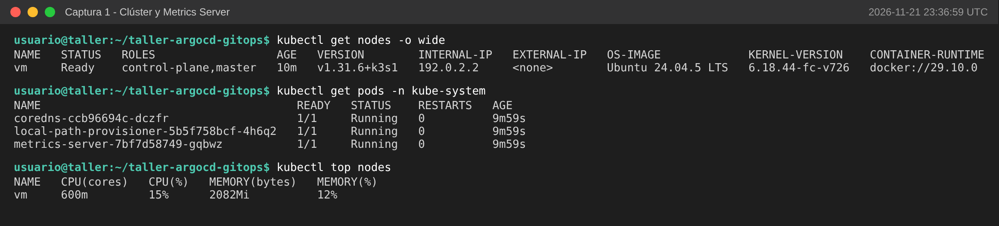

### Paso 1 — Instalación de Argo CD

```bash
kubectl create namespace argocd
kubectl apply -n argocd --server-side -f https://raw.githubusercontent.com/argoproj/argo-cd/v2.14.11/manifests/install.yaml
kubectl get pods -n argocd
kubectl -n argocd get secret argocd-initial-admin-secret -o jsonpath="{.data.password}" | base64 -d
```

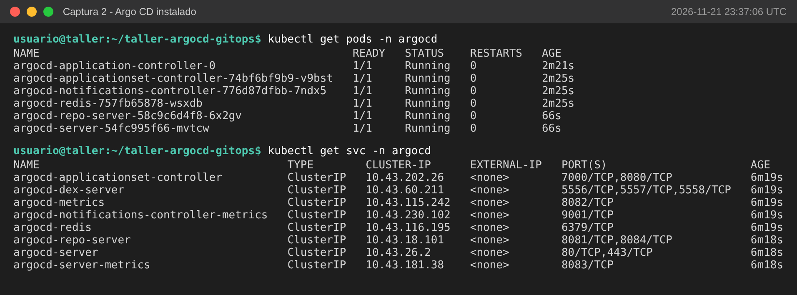

Acceso a la interfaz web con el usuario `admin` (la contraseña aparece enmascarada):

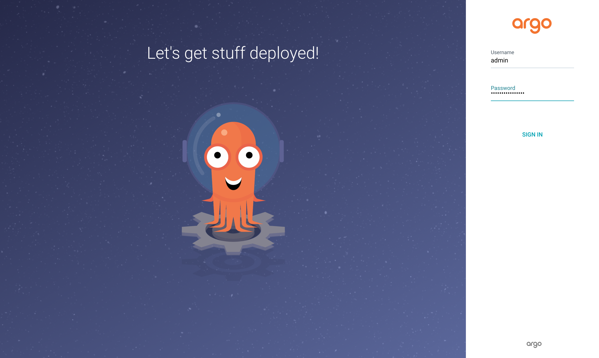

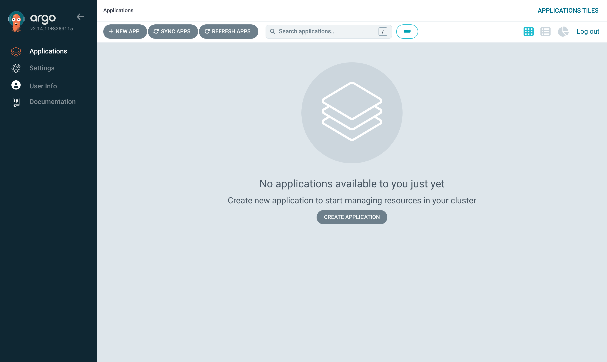

### Paso 2 — Creación de la Application (path `k8s`, Automated Sync)

```bash
kubectl apply -f argocd/application.yml
```

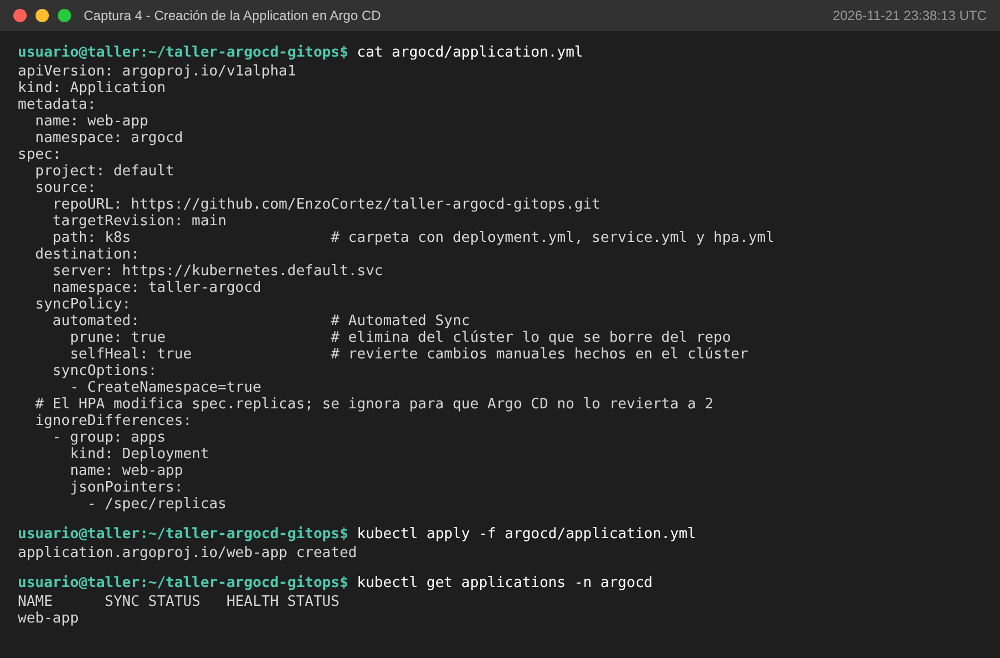

Argo CD clonó el repositorio, leyó la carpeta `k8s/` y creó el namespace y los recursos sin
intervención manual. La aplicación queda **Synced** con la revisión `main (7c67022)` y
**Healthy**, con el mensaje *"Auto sync is enabled"*. El árbol muestra
Deployment → ReplicaSet → 2 Pods, el Service (con Endpoints) y el HPA:

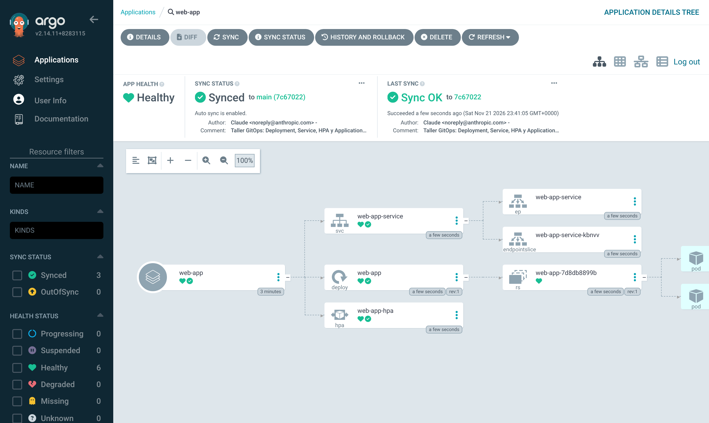

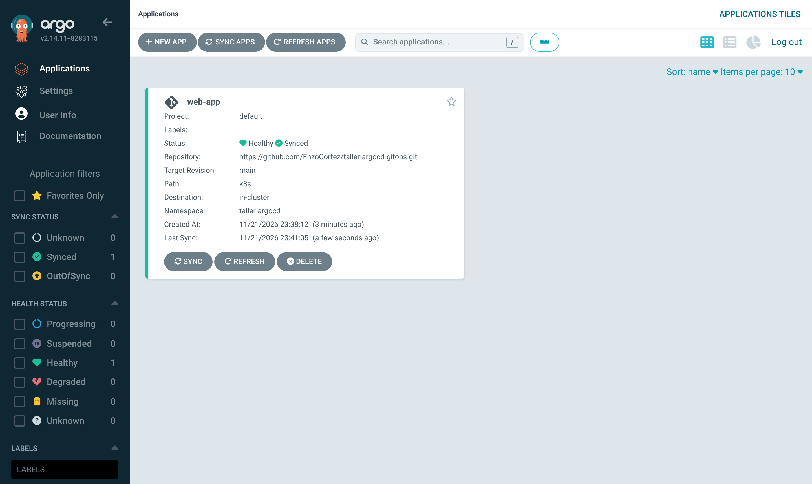

En el detalle se ven el **REPO URL**, el **PATH `k8s`**, la **TARGET REVISION `main`** y la
**SYNC POLICY** con *Automated*, *Prune Resources* y *Self Heal* activados:

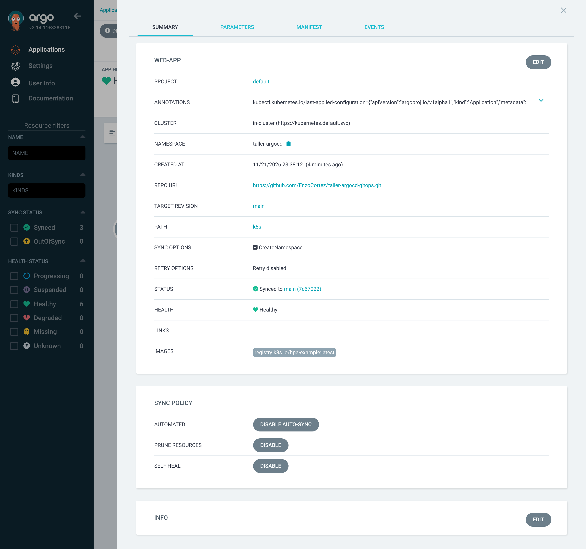

### Paso 3 — Verificación del Deployment y del Service

```bash
kubectl get all -n taller-argocd
kubectl get pods -n taller-argocd --show-labels
kubectl get endpoints web-app-service -n taller-argocd
kubectl describe deployment web-app -n taller-argocd
```

- 2 Pods `Running` con las labels `app=web-app,tier=frontend`.
- El Service `NodePort 80:30080/TCP` tiene como endpoints las IP de los 2 Pods en el puerto 80,
  lo que confirma que el selector coincide con las labels.
- El Deployment muestra requests (200m / 64Mi), limits (500m / 128Mi) y las probes.

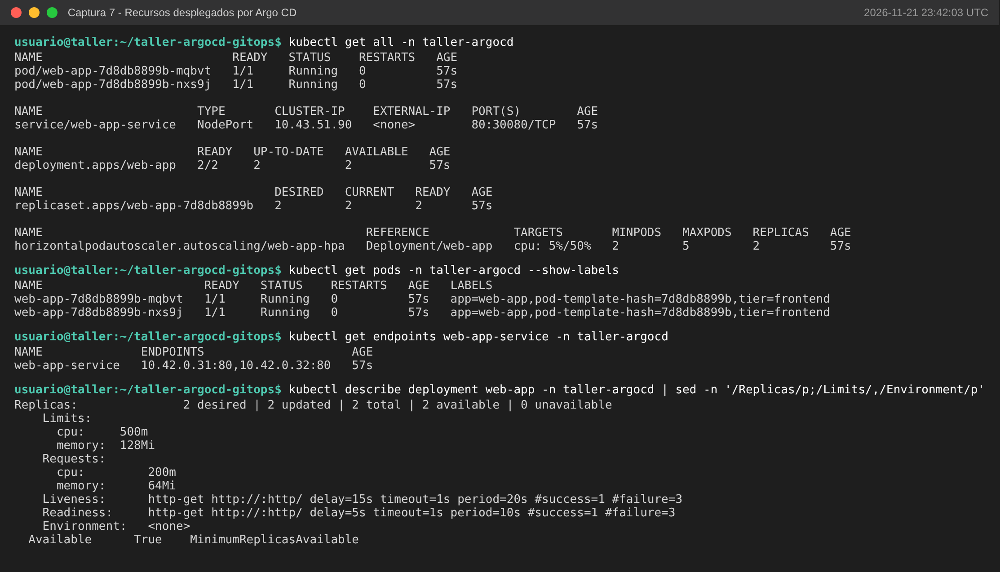

```bash
curl http://192.0.2.2:30080
```

La aplicación responde `OK!` con HTTP 200 a través del NodePort:

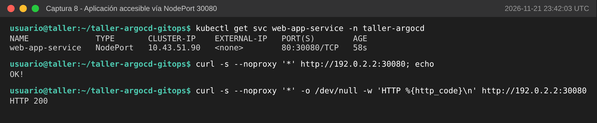

### Paso 4 — Horizontal Pod Autoscaler

**En reposo:** `cpu: 4%/50%`, 2 réplicas (el mínimo).

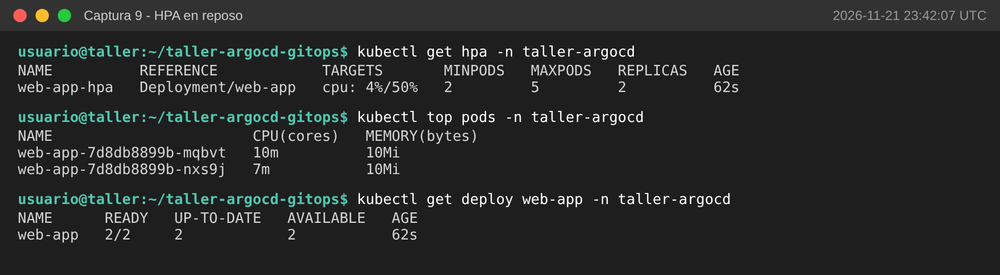

**Bajo carga:**

```bash
kubectl run load-generator -n taller-argocd --image=busybox:1.36 --restart=Never -- \
  /bin/sh -c "for i in 1 2 3 4; do (while true; do wget -q -O- http://web-app-service >/dev/null; done) & done; wait"
kubectl get hpa web-app-hpa -n taller-argocd --watch
```

La CPU subió a **214 %** del request (unos 340–440m por Pod). El HPA escaló de
**2 → 4 → 5** réplicas en unos 30 segundos y se detuvo en el máximo configurado (5).

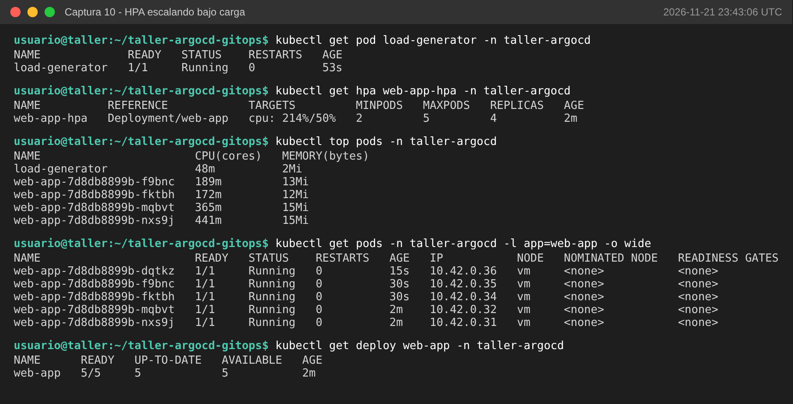

Durante la carga, Argo CD muestra los 5 Pods y la aplicación sigue **Synced**: el cambio de
réplicas hecho por el HPA no se considera una desviación respecto a Git.

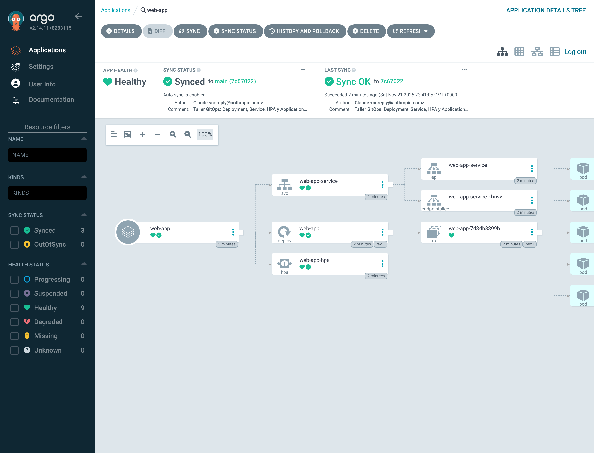

**Al detener la carga:** pasados los ~5 minutos de ventana de estabilización, el HPA bajó a
**2 réplicas** (`New size: 2; reason: All metrics below target`). La condición
`ScalingLimited: TooFewReplicas` confirma que se respeta el mínimo de 2.

```bash
kubectl describe hpa web-app-hpa -n taller-argocd
```

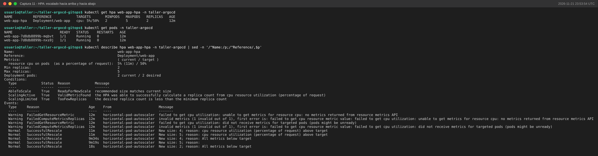

> Los avisos `FailedGetResourceMetric` del principio son normales: aparecen durante el primer
> minuto, mientras Metrics Server aún no tiene métricas de los Pods recién creados.

### Paso 5 — GitOps: sincronización automática al cambiar el repositorio

Se modificó `k8s/deployment.yml` (label `version`) y se hizo push a `main`. **No se pulsó
Sync ni Refresh**: Argo CD detectó el commit por sí mismo.

**Primer cambio (`version: "v2"`, commit `85edfd7`):**

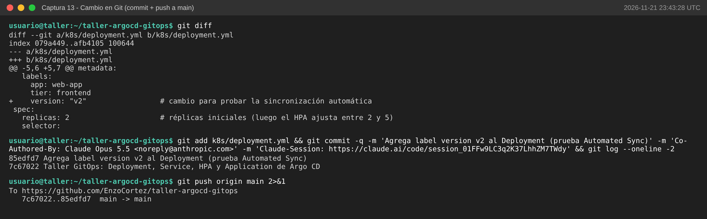

**Segundo cambio (`version: "v3"`, commit `a7d0f3f`), hecho con el HPA escalado a 5 réplicas:**

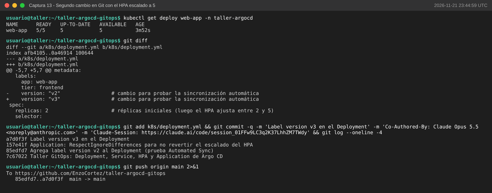

Argo CD sincronizó automáticamente la nueva revisión `a7d0f3f`. El Deployment tiene la label
`version=v3` y **mantiene las 5 réplicas** del HPA:

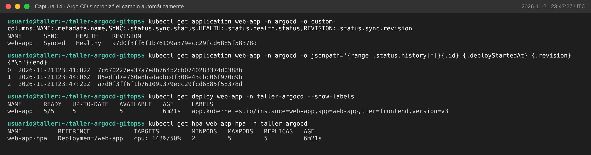

El historial (*History and Rollback*) muestra las tres revisiones desplegadas, todas con
**"Initiated by: automated sync policy"**:

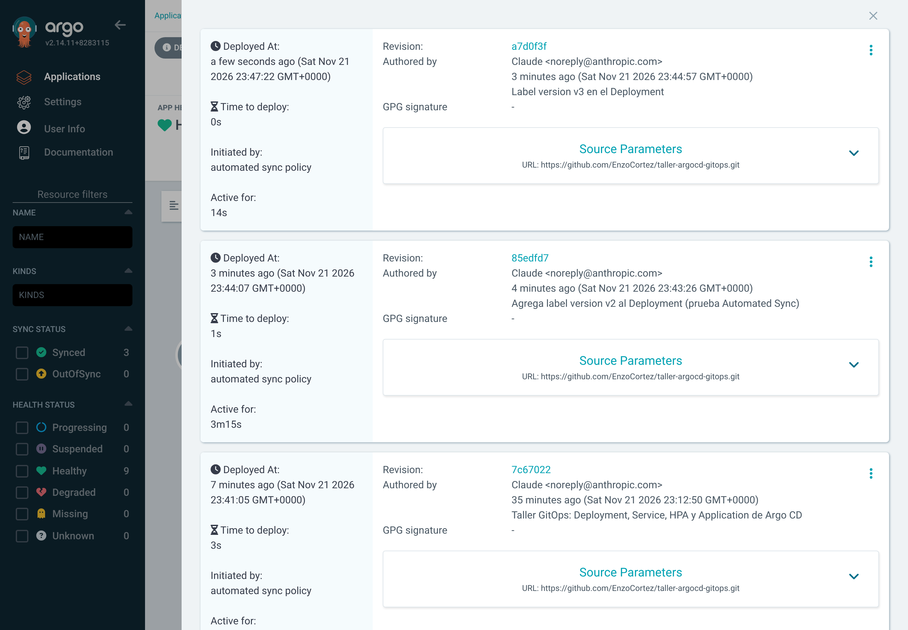

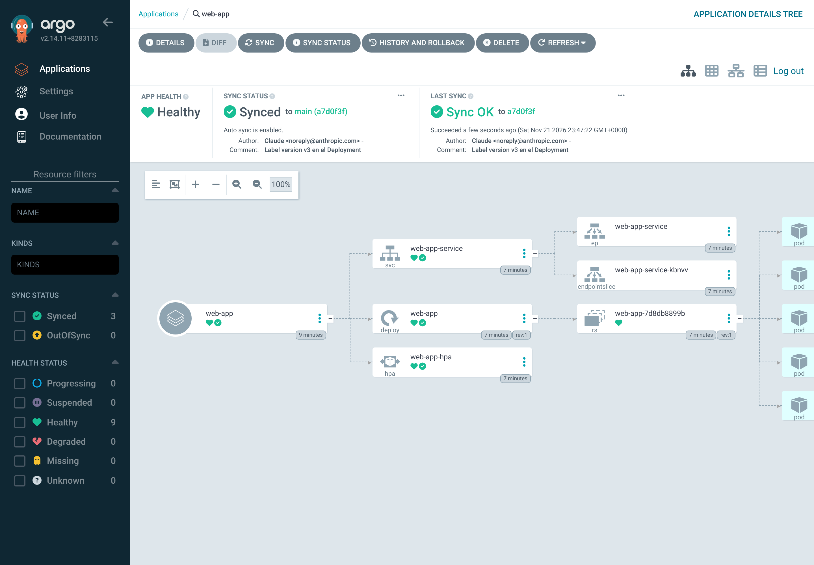

**Self Heal:** se borró a mano el Service del clúster. Argo CD detectó la diferencia con Git y
lo recreó solo en segundos; la aplicación volvió a responder `OK!`.

```bash
kubectl delete svc web-app-service -n taller-argocd
kubectl get svc -n taller-argocd
```

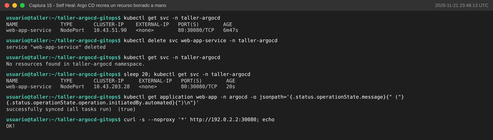

---

## 5. Problema encontrado y solución: Argo CD frente al HPA

En el primer cambio (`v2`) el HPA tenía 5 réplicas y, al sincronizar, el Deployment **volvió
de golpe a 2** (evento `Scaled down replica set ... to 2 from 5` sin un `SuccessfulRescale`
del HPA). Esto pasa porque `ignoreDifferences` solo excluye el campo de la **comparación**. Al
aplicar el manifiesto en un sync, Argo CD seguía enviando `replicas: 2`.

**Solución:** añadir la opción `RespectIgnoreDifferences=true` en `syncOptions` (commit
`157e41f`). Con ella, Argo CD también excluye `/spec/replicas` al aplicar. El segundo cambio
(`v3`) se sincronizó **sin tocar las 5 réplicas** (capturas 13b, 14a y 14c).

Otra alternativa sería quitar `spec.replicas` del Deployment y dejar que lo gestione solo el
HPA. Aquí se mantiene porque el enunciado pide configurar 2 réplicas iniciales.

## 6. Resultados

| Requisito | Resultado | Evidencia |
|---|---|---|
| Deployment con 2 réplicas, labels/selectors, requests/limits y puerto | ✅ | Capturas 5, 7 |
| Service NodePort con port/targetPort, asociado por labels y accesible | ✅ `OK!` en `:30080` | Capturas 7, 8 |
| Metrics Server en el clúster | ✅ | Captura 1 |
| HPA min 2 / max 5 / CPU 50 % asociado al Deployment | ✅ | Capturas 9, 11 |
| El HPA escala hacia arriba y hacia abajo según la carga | ✅ 2 → 4 → 5 → 2 | Capturas 10, 11, 12 |
| Application de Argo CD apuntando al repo, path `k8s` | ✅ | Capturas 4, 5, 6 |
| Automated Sync | ✅ 3 revisiones sincronizadas por la política automática | Capturas 13, 14 |
| Self Heal | ✅ Service recreado automáticamente | Captura 15 |

## 7. Conclusiones

- Con GitOps, el repositorio Git es la única fuente de verdad: el estado del clúster se
  declara en YAML y Argo CD lo reconcilia sin `kubectl apply` manuales de la aplicación. Un
  `git push` bastó para desplegar cada cambio, en menos de 3 minutos.
- `selfHeal` corrige desviaciones manuales en el clúster y `prune` elimina lo que se quita del
  repositorio. El historial de Argo CD deja trazabilidad de cada revisión desplegada y permite
  hacer rollback.
- El HPA necesita **Metrics Server** y **requests de CPU**, porque el porcentaje de utilización
  se calcula sobre el request. Escaló hasta el máximo en segundos y bajó tras la ventana de
  estabilización de 5 minutos.
- Cuando un HPA gestiona las réplicas no basta con `ignoreDifferences`: también hace falta
  `RespectIgnoreDifferences=true` para que la sincronización no deshaga el autoescalado.

## 8. Limpieza

```bash
kubectl delete -f argocd/application.yml
kubectl delete namespace taller-argocd
```
